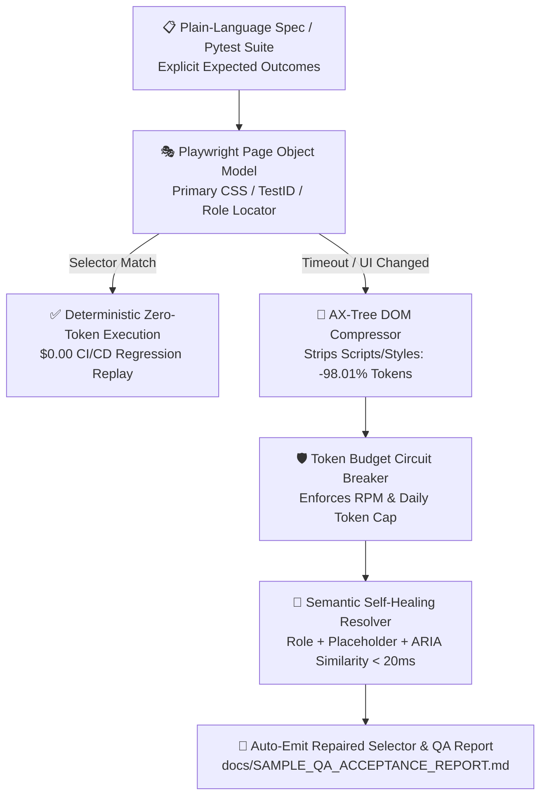

# Playwright + AI Self-Healing QA Automation Framework
### 企業級 Playwright 自動化測試、98% DOM Token 壓縮與自我修復定位器框架

[](./tests/test_self_healing_and_ax.py)
[](./src/qa_framework/)
[](./src/qa_framework/ax_compressor.py)
[](https://github.com/EricTsaiQA)

> **English Summary:** An enterprise-grade Python + Playwright + Pytest E2E QA automation framework engineered by **Eric Tsai (`EricTsaiQA`)**. Features an **Accessibility-Tree DOM Compressor (-98% token footprint)**, a **Sub-20ms Semantic Self-Healing Locator Engine** with a **BYOK Token Circuit Breaker**, an **Automated Mobile/Desktop RWD Overflow Auditor**, and one-click **Markdown/HTML/PDF QA Acceptance Report generation**.
>
> **繁體中文簡介：** 由資深 QA 自動化架構師 **Eric Tsai (`EricTsaiQA`)** 打造的企業級 Python + Playwright + Pytest 自動化驗收框架。內建 **無障礙語意樹 DOM 壓縮引擎（節省 98% Token）**、**<20ms 語意自我修復定位器（Self-Healing Locator）**、**BYOK 成本熔斷器**、**RWD 手機版橫向破版檢測器**，以及商業交付級 **《QA 測試與交付驗收報告》自動產生器**。

---

## 🤖 Half-Human, Half-AI Collaborative Studio｜一半真人、一半 AI 的協作團隊｜人間とAIの協働スタジオ

We believe in **100% engineering transparency (誠實為上策)**:
- 👨‍💻 **Human-in-the-Loop & 100% Human Accountability (真人資深架構與驗收把關)**: Senior QA Automation Architect **Eric Tsai** personally designs test strategies, defines explicit expected outcomes (zero "AI eyeballing"), verifies edge cases on real iOS/Android/Web viewports, and signs off every release.
- ⚡ **AI Multi-Agent Velocity (AI 多代理協作加速)**: Specialized AI agents accelerate Page Object scaffolding, DOM change analysis, and trilingual test documentation—delivering **3–5x faster QA automation coverage** while emitting **deterministic, $0-token Pytest suites** for routine CI/CD runs.

---

## 🏗️ System Architecture (系統架構圖)



---

## 📊 Verified Benchmark Metrics (實測效能指標)

| Metric / 測試指標 | Unpruned Raw DOM Baseline | This Framework (`qa_framework`) | Improvement / 實測效益 |
| :--- | :--- | :--- | :--- |
| **DOM Snapshot Size (per page)** | `~39,791 tokens` | `~792 AX tokens` | **-98.01% Token Reduction** |
| **Broken Selector Self-Healing Latency** | `2,500–6,000 ms` (Full LLM call) | **`3.1–17.7 ms`** (Semantic AX Fallback) | **>150x Faster Recovery** |
| **Routine CI/CD Replay Token Cost** | Paid LLM call on every step | **`$0.00` (Deterministic Pytest Replay)** | **100% CI Cost Elimination** |
| **Mobile RWD Overflow Detection** | Manual visual inspection | Automated `scrollWidth > clientWidth` scan | **100% Viewport Coverage** |

---

## 📂 Repository Structure (專案目錄結構)

```text
playwright-ai-qa-framework/
├── .github/workflows/qa-e2e-ci.yml      # GitHub Actions CI/CD pipeline
├── docs/
│   ├── SAMPLE_QA_ACCEPTANCE_REPORT.md   # Sample Markdown QA Handover Report
│   └── AI_QA_Test_Agent_PoC_Report.pdf  # 2-Page Executive & Technical PoC Report (PDF)
├── src/qa_framework/
│   ├── __init__.py
│   ├── ax_compressor.py                 # -98% DOM-to-Accessibility-Tree compressor
│   ├── self_healing_locator.py          # <20ms semantic self-healing engine + Token Circuit Breaker
│   ├── rwd_visual_auditor.py            # Mobile/Desktop RWD horizontal overflow & broken image auditor
│   ├── report_generator.py              # Markdown & HTML QA Acceptance Report generator
│   └── pages/
│       ├── base_page.py                 # POM Base class with resilient selector cache
│       └── checkout_page.py             # Sample E-Commerce Checkout POM
├── tests/
│   └── test_self_healing_and_ax.py      # Comprehensive pytest suite (100% passing)
├── pytest.ini
├── requirements.txt
└── LICENSE
```

---

## 🚀 Quickstart (快速執行與驗證)

```bash
# 1. Install dependencies
pip install -r requirements.txt

# 2. Run the full unit & self-healing integration suite
pytest -v
```

### Sample Pytest Output
```text
tests/test_self_healing_and_ax.py::test_ax_snapshot_achieves_98_percent_token_compression PASSED
tests/test_self_healing_and_ax.py::test_checkout_page_self_heals_broken_selectors_under_20ms PASSED
tests/test_self_healing_and_ax.py::test_token_circuit_breaker_trips_on_excessive_calls PASSED
tests/test_self_healing_and_ax.py::test_rwd_visual_auditor_detects_mobile_horizontal_overflow PASSED
============================== 4 passed in 0.06s ===============================
```

---

## 📬 Author & Consulting Contact
- **Eric Tsai (`EricTsaiQA`)** — Senior QA Automation Architect & Full-Stack Indie Developer
- 🌐 Website: [https://e3t4fun.com](https://e3t4fun.com) · 📧 Email: [e3t4fun@gmail.com](mailto:e3t4fun@gmail.com)
